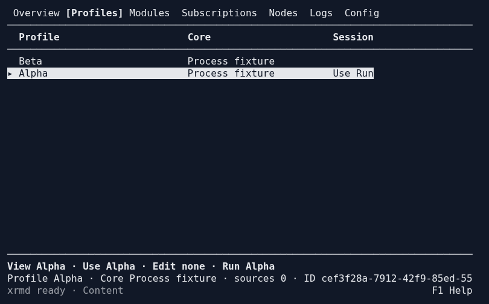
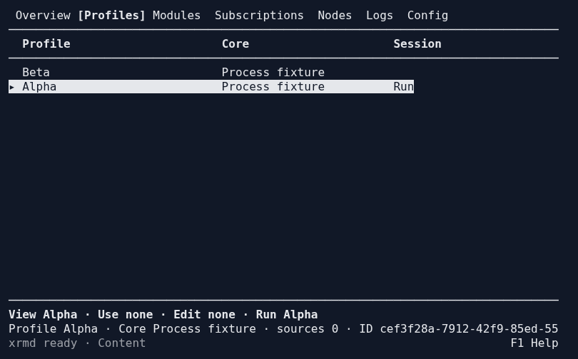
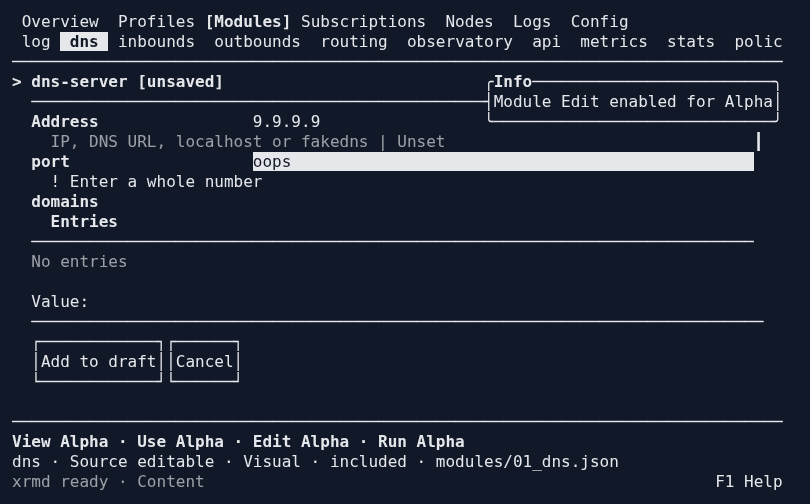
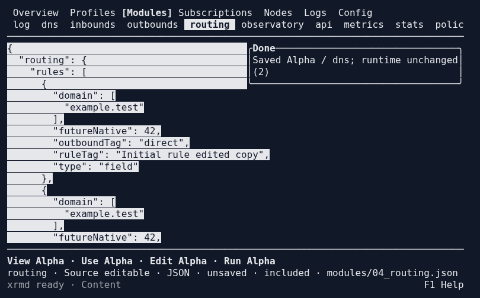
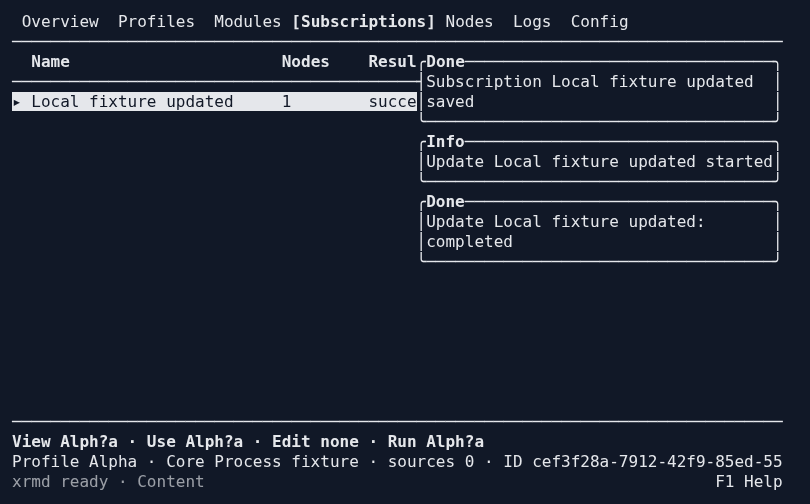
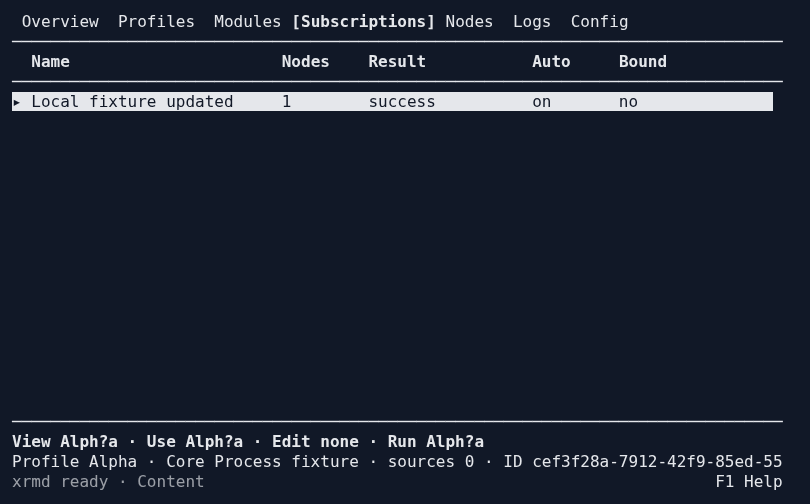
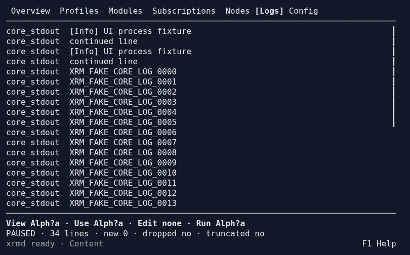
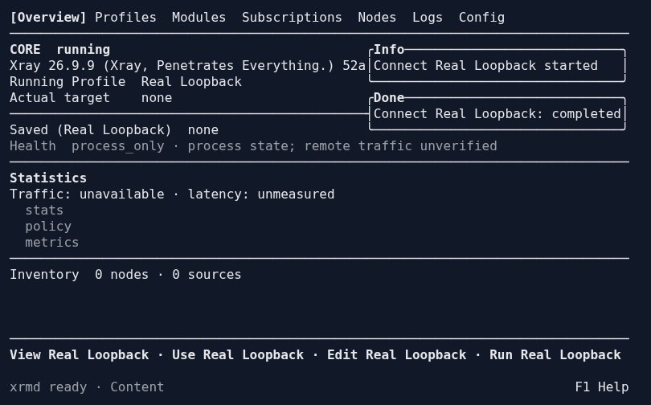

# 实际终端与操作证据

来自本轮隔离实例。TXT 是 `tmux capture-pane` 的当前屏幕格，ANSI 保留样式；HTML/PNG 是对这些实际 ANSI 格的呈现（默认深色底），不是设计稿或生成的假界面，也不是对物理终端窗口的摄影。每组操作与数据结果见 trace；二进制身份见 [摘要](binary-sha256.json)。

## 代表性屏幕

### Profiles 详情在底部，Use 可取消

### DNS 多字段表单：错误后保留全部值与焦点

### Routing 集合修改、复制和重排后的同一 JSON 草稿

### 订阅通知出现与自动消失

### 日志正文与底部状态分离

### 真实 Xray，经 TUI 保存后连接

DNS/routing 表单操作后，curl 经隔离 SOCKS listener 访问 loopback HTTP，返回 `xrm-real-component-loopback`。未使用公网代理或真实订阅。

## 原始记录

- [22 组屏幕的按键、对象、源文件与运行事实](terminal-trace.json)。覆盖 80×24、120×40、180×48 和 70×20 保护恢复。
- [真实核心表单→多文件→SOCKS 流量与退出保活](real-core-trace.json)。固定 Xray 版本、摘要、PID、confdir 和源内容均记录在内。
- [Config 21 个操作场景](config-steps.json)：Core、Tests、Editor、Appearance、Geodata 的正常/失败/绑定/只读。
- [CLI stdout、stderr、退出码捕获](cli-output.json)：实际命令树帮助、输出、watch、管道与断线。
- MCP 当前宿主的独立隔离体验入口截图：[TXT](mcp-final-overview.txt)、[ANSI](mcp-final-overview.ansi)。会话中的体验脚本已正常退出 0 并清理自身临时数据。
- [真实核心门禁](real-core-results.txt)、[组件](components-final.txt)、[原生表单](forms-final.txt)、[外部编辑器复验](external-editor-final.txt)。

初次失败日志保留供定位，不能单独当作最终状态：[测试迁移与复验说明](../../tui-acceptance-migration.md)、[统一执行记录](../../component-ui-rewrite-execution.md)。G5 仍待用户人工验收。
