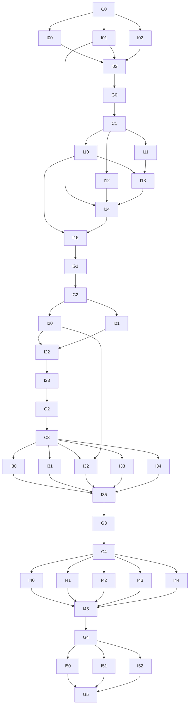

# XRM 任务 DAG 与子 Agent 执行契约

**状态：实施任务基线 · 2026-09-23 · 尚未执行任何编码任务**

依据：[需求](requirements.md)、[架构](architecture.md)、[实现接口](implementation-plan.md)、[测试标准](testing-standard.md)、[AGENTS.md](../AGENTS.md)。本文件只调度开发工作，**不是要在 xrmd 中实现任务图/工作流引擎**。

## DAG-01　任务图怎样执行

需求/架构已确认；C0–C4只冻结当前阶段的共享头文件与wire契约，不重新讨论产品定位。每个实施任务内部必须按 `接口声明 → 红测试 → 实现 → 绿测试 → 交接` 执行。G0–G5是集成验收门，不是简单的“所有子任务结束”。

### 任务就绪条件

一个任务只有在以下条件都满足时才可启动：前置任务已经合并到集成分支并通过它们的验收；本阶段获用户授权；所需公开契约已冻结；其可写文件范围与当前其他任务不冲突。

同阶段独立任务可以并行，不等待整层实现完毕才写测试。用户只授权M0时，只能安排C0/I00–I03/G0；DAG不是对所有后续阶段的自动执行授权。

“契约通过编译”不等于“业务完成”。骨架不得在生产命令中返回成功；红测试应因契约行为缺失失败，而不是以拼错include或找不到测试目标冒充有效RED。

## DAG-02　角色与文件所有权

- **主 Agent / 集成人：** 唯一共享契约负责人，安排任务、合并构建变更、处理接口修正与阶段验收；不是包办全部模块实现。
- **模块子 Agent：** 在授权文件范围内写接口契约对应测试与实现，交付一个可独立测试的闭环。
- **审查子 Agent（可选）：** 只读审查接口/测试及边界；不在被审查任务的文件里同时修代码。发现问题交owner修改。

一个文件同一时刻只有一个写owner。共享 `src/model/*.hpp`、`contract/dtos.hpp`、`contract/methods.hpp`、根CMake、公共test支持由当前C任务/集成人负责；叶任务需要修改时提交最小建议，由owner统一落地。

同仓库优先每任务单独git worktree/分支；没有worktree能力时只能并行互不重叠目录。子Agent在自己的worktree为编译新增源文件产生的CMake改动，可作为独立构建patch交集成人，**不能各自向共享主分支覆盖根CMake**。集成人合并patch后必须重跑测试；不把某个分支未合并构建改动上的日志当最终证据。

不设一个要求所有模块空实现先合并的“大框架任务”。测试需要尚未完成的I/O时可使用测试专用fixture；真正模块依赖由depends_on明确，阶段门不得继续用替身冒充已完成模块。

## DAG-03　阶段和可并行窗口

| 阶段 | 并行窗口（前置满足后） | 集成点 |
|---|---|---|
| M0 | I00库存、I01进程、I02IPC | I03 → G0 |
| M1 | I10原生模块、I11Codec、I12文件输出；I10/I11完成后I13组装 | I14 → I15 → G1 |
| M2 | I20 HTTP、I21解析/匹配 | I22 → I23 → G2 |
| M3 | I30绑定、I31组装、I32观测、I33生命周期、I34表单 | I35 → G3 |
| M4 | I40 VMess、I41 Trojan/SS、I42 HY2、I43安装、I44高级编辑 | I45 → G4 |
| M5 | I50打包、I51真实回归、I52交互/性能验收 | G5 |

默认同时派2–3个实现任务即可；是否提高并行度取决于上下文与机器资源，不以“最多能开多少Agent”作为目标。任务合并与集成门按顺序进行。

## DAG-04　依赖图

以下Mermaid只是文档图，可不渲染；后面的JSON清单才是便于读取的完整依赖数据。



C1/C2/C3/C4依赖前一阶段门，不能因为共享头文件可以提前写就跨阶段实施。上图中没有画出的公共头文件依赖也由对应C任务锁定。

## DAG-05　所有任务卡

每张卡列出的测试编号在 testing-standard.md 有对应行为。公共头文件修改遵守DAG-02；函数签名以implementation-plan.md的IF编号为准。每个实现任务必须先添加/运行这些测试，再完成函数体；不是实现后补一个只匹配现有代码的测试。

### C0 · 冻结最小公共契约与测试入口

**阶段：M0 · 类型：contract · 前置：无**

**基线条款：** R01、R03、R13、R15、R16；本任务测试对应的T编号见测试标准TS-07。

让后续三个基础分支使用同一套类型、错误与最小M0签名，并可以独立编译测试。

**可写范围：** `CMakeLists.txt`；`CMakePresets.json`；`src/model/common.hpp`；`src/model/node.hpp`；`src/model/runtime.hpp`；`src/contract/wire.hpp`；`src/contract/dtos.hpp`；`src/infra/store.hpp`；`src/infra/process.hpp`；`src/client/rpc_client.hpp`；`src/server/rpc_server.hpp`；`tests/support/*`；`tests/contract/*`。

**交付：** 只建立M0用到的共享头文件；后续接口仍只留在实施文档；CMake dev/asan、Catch2/CTest与最小测试支持；fake-core测试辅助程序的version/exit/argv记录场景；不链接进产品；约定wire模型和序列化责任；编译契约测试。

**先行测试/验收：** `CT-01`、`CT-02`。

**明确不做：** 不创建全部15模块业务类、订阅/Installer/CoreManager空实现；不将骨架构建成功当成M0完成。

### I00 · SQLite节点库存与管理索引

**阶段：M0 · 类型：implementation · 前置：C0**

**基线条款：** R01、R03、R13、R15、R16；本任务测试对应的T编号见测试标准TS-07。

手工节点能保存、列表、读取、修改、复制、删除，并在Server重启后保留。

**可写范围：** `src/infra/store.cpp`；`src/model/json_models.cpp`；`tests/integration/store/*`；`tests/fixtures/store/*`。

**交付：** Store节点与核心/Profile索引的M0实现；Node必要JSON序列化和SQLite短事务；临时真实数据库测试；列表不泄漏秘密的DTO样例。

**先行测试/验收：** `DB-01`、`CT-02`。

**明确不做：** 不在库里建立DNS、routing、groups镜像；不加入尚未发生的版本迁移平台。

### I01 · 进程适配与系统核心版本读取

**阶段：M0 · 类型：implementation · 前置：C0**

**基线条款：** R01、R03、R13、R15、R16；本任务测试对应的T编号见测试标准TS-07。

安全地启动给定可执行文件，取得版本/退出结果，为后续核心生命周期提供真实Process能力。

**可写范围：** `src/infra/process.cpp`；`src/xray/process_adapter.hpp`；`src/xray/process_adapter.cpp`；`tests/integration/process/*`。

**交付：** libuv进程、管道、短命execute与回收；version命令、非零/超时/信号分类；路径含空格、stdout/stderr分离等fake-core测试。

**先行测试/验收：** `PROC-01`、`PROC-02`、`PROC-03`。

**明确不做：** 不启动生产代理，不扫描接管系统PID；不引入shell启动、Go/libXray或额外watchdog。

### I02 · UDS请求响应传输

**阶段：M0 · 类型：implementation · 前置：C0**

**基线条款：** R01、R03、R13、R15、R16；本任务测试对应的T编号见测试标准TS-07。

两个进程通过JSON Lines发送请求并取得结构化结果，不依赖业务实现。

**可写范围：** `src/contract/wire.cpp`；`src/client/rpc_client.cpp`；`src/server/rpc_server.cpp`；`tests/integration/rpc_transport/*`。

**交付：** 半包/粘包/EOF/帧大小处理；客户端pending请求与关闭回调；Server连接管理；测试专用handler验证帧，不返回生产假业务。

**先行测试/验收：** `RPC-01`、`RPC-02`。

**明确不做：** 不做HTTP/WebSocket、远程认证、事件回放；不自动重发写请求。

### I03 · 组合Server与CLI最小用户闭环

**阶段：M0 · 类型：implementation · 前置：I00, I01, I02**

**基线条款：** R01、R03、R13、R15、R16；本任务测试对应的T编号见测试标准TS-07。

用户可运行xrmd，经xrm登记核心、导入一个手工节点、保存并列出。

**可写范围：** `apps/xrm_main.cpp`；`apps/xrmd_main.cpp`；`src/server/application.hpp`；`src/server/application.cpp`；`src/server/api_router.hpp`；`src/server/api_router.cpp`；`src/contract/methods.hpp`；`src/cli/commands.hpp`；`src/cli/commands.cpp`；`src/cli/node_commands.cpp`；`src/cli/core_commands.cpp`；`src/cli/print.cpp`；`tests/integration/m0/*`。

**交付：** 真实CLI->UDS->Application->Store/Process流程；system核心登记不复制/覆盖原程序；Server不可达错误、--json stdout/stderr与退出码。

**先行测试/验收：** `E2E-01`、`CLI-01`。

**明确不做：** 不实现未来RPC假成功，不铺未来TUI菜单；不实现订阅下载、连接和所有模块。

### G0 · M0集成门

**阶段：M0 · 类型：gate · 前置：I03**

**基线条款：** R01、R03、R13、R15、R16；本任务测试对应的T编号见测试标准TS-07。

证明M0是可操作的两进程应用，不是只有库层测试。

**可写范围：** `tests/integration/gates/m0.cpp`。

**交付：** 在干净临时目录重现核心登记、节点保存、Server重启、节点列表；集成分支构建与测试记录。

**先行测试/验收：** `E2E-01`、`CT-01`、`CLI-01`。

**明确不做：** 不因阶段通过自动授权M1。

### C1 · 冻结原生模块、FileSet与运行接口

**阶段：M1 · 类型：contract · 前置：G0**

**基线条款：** R05、R06、R10–R12、R15；本任务测试对应的T编号见测试标准TS-07。

固定15模块、Profile、运行文件集合及生命周期接口，允许Profile、Codec、文件落盘分开实现。

**可写范围：** `src/model/node.hpp`；`src/model/json_models.cpp`；`src/model/profile.hpp`；`src/model/module_catalog.hpp`；`src/model/runtime.hpp`；`src/profile/profile_service.hpp`；`src/xray/runtime_assembler.hpp`；`src/xray/runtime_writer.hpp`；`src/xray/core_manager.hpp`；`src/xray/codecs/codec.hpp`；`src/contract/dtos.hpp`；`src/contract/methods.hpp`；`tests/contract/m1/*`。

**交付：** IF-02/03/07/08/09/10当期声明；固定OutputFile/PreparedFiles返回值，禁止整配置Json返回；本阶段核心检查/启动fake-core场景补齐。

**先行测试/验收：** `CT-01`、`CT-02`。

**明确不做：** 不提前加入动态组/订阅字段的产品代码；不以接口数量衡量功能完成。

### I10 · 原生15模块与Profile持久化

**阶段：M1 · 类型：implementation · 前置：C1**

**基线条款：** R05、R06、R10–R12、R15；本任务测试对应的T编号见测试标准TS-07。

每个原生模块都能列表、原文读取/编辑、启停及独立保存；Profile拥有原生模块文件。

**可写范围：** `src/model/module_catalog.cpp`；`src/profile/profile_service.cpp`；`src/infra/files.hpp`；`src/infra/files.cpp`；`presets/local/*`；`tests/unit/modules/*`；`tests/integration/profile/*`。

**交付：** 全15项catalog与默认文件映射；文本保留、局部冲突、单文件原子替换；一次性local预设；选择与环境存profile.json。

**先行测试/验收：** `MOD-01`、`MOD-02`、`MOD-03`、`MOD-04`、`MOD-05`、`MOD-06`、`MOD-07`、`MOD-08`、`DB-05`。

**明确不做：** 不把模块镜像写进SQLite；不要求15套复杂表单，不把保存等同连接。

### I11 · 首个VLESS与原生outbound Codec

**阶段：M1 · 类型：implementation · 前置：C1**

**基线条款：** R05、R06、R10–R12、R15；本任务测试对应的T编号见测试标准TS-07。

同一typed Node可以从URI导入并生成合法位置的原生outbound；原生高级节点不丢字段。

**可写范围：** `src/xray/codecs/vless.cpp`；`src/xray/codecs/stream.cpp`；`src/xray/codecs/codec.cpp`；`tests/unit/codecs/vless.cpp`；`tests/unit/codecs/native.cpp`；`tests/fixtures/codecs/vless/*`；`tests/fixtures/codecs/native/*`。

**交付：** VLESS常用RAW/TLS/REALITY/XHTTP映射的批准fixture；原生单outbound/集合导入边界；错误字段位置与不支持参数报告。

**先行测试/验收：** `CODEC-01`、`CODEC-02`、`CODEC-07`、`CODEC-08`。

**明确不做：** 不顺便实现其他协议；不调用libXray、不直接读写运行目录。

### I12 · FileSet物化与多文件导出

**阶段：M1 · 类型：implementation · 前置：C1**

**基线条款：** R05、R06、R10–R12、R15；本任务测试对应的T编号见测试标准TS-07。

给定文件集合得到一个全新confdir，无旧文件残留且不修改active。

**可写范围：** `src/xray/runtime_writer.cpp`；`tests/integration/runtime_writer/*`。

**交付：** candidate/preview目录创建、失败清理、受控导出；文件名/归属检查、无可写硬链接；多文件真实磁盘测试。

**先行测试/验收：** `WRITE-01`、`WRITE-02`、`WRITE-03`、`WRITE-04`。

**明确不做：** 不解析Xray模块语义，不启动核心；不建立增量编译或内容寻址缓存。

### I13 · 单节点原生模块组装

**阶段：M1 · 类型：implementation · 前置：C1, I10, I11**

**基线条款：** R05、R06、R10–R12、R15；本任务测试对应的T编号见测试标准TS-07。

把保存的原生模块与单节点选择准备成多文件结果，不形成大JSON。

**可写范围：** `src/xray/runtime_assembler.cpp`；`src/xray/writers/native.cpp`；`src/xray/writers/outbounds.cpp`；`src/xray/writers/routing.cpp`；`src/xray/writers/observation.cpp`；`tests/unit/assembly/basic/*`。

**交付：** 普通模块字节保留、静态出站与nodes_tail；单节点选择与原生路由追加默认目标；全部模块独立输出/停用测试，类型例外保留。

**先行测试/验收：** `ASM-01`、`ASM-02`、`ASM-03`、`ASM-06`、`ASM-07`、`ASM-08`。

**明确不做：** 不做动态组算法与M3行为假实现；不访问文件、库、网络或进程。

### I14 · 检查、启动、停止、重启与日志

**阶段：M1 · 类型：implementation · 前置：I12, I13, I01**

**基线条款：** R05、R06、R10–R12、R15；本任务测试对应的T编号见测试标准TS-07。

准备候选、检查同一目录、启动独立核心、观察输出和停止自己的进程。

**可写范围：** `src/xray/core_manager.cpp`；`src/infra/store.cpp`；`src/model/json_models.cpp`；`src/server/log_buffer.hpp`；`src/server/log_buffer.cpp`；`tests/integration/lifecycle/basic/*`。

**交付：** CoreManager初始生命周期；检查失败旧进程不动；基本启动失败一次恢复，保存RunRecord；生产/check句柄分离和有界日志。

**先行测试/验收：** `LIFE-01`、`LIFE-02`、`LIFE-03`、`LIFE-06`、`PROC-04`、`LOG-01`。

**明确不做：** 不把readiness等同公网连通；不引入通用热重载或永久API选择同步。

### I15 · 单节点连接的CLI/TUI闭环

**阶段：M1 · 类型：implementation · 前置：I10, I14**

**基线条款：** R05、R06、R10–R12、R15；本任务测试对应的T编号见测试标准TS-07。

用户管理全部模块，选择节点并连接，查看日志，退出TUI核心继续运行。

**可写范围：** `src/server/application.cpp`；`src/server/api_router.cpp`；`src/server/operations.hpp`；`src/server/operations.cpp`；`src/cli/profile_commands.cpp`；`src/cli/runtime_commands.cpp`；`src/tui/app.hpp`；`src/tui/app.cpp`；`src/tui/state.hpp`；`src/tui/actions.hpp`；`src/tui/actions.cpp`；`src/tui/modules.cpp`；`src/tui/overview.cpp`；`src/tui/logs.cpp`；`apps/xrm_main.cpp`；`apps/xrmd_main.cpp`；`tests/integration/m1/*`；`tests/tui/m1/*`。

**交付：** 公开select/connect/apply/stop/render/check/dump接口；15项统一模块页与原文编辑；实际期望/运行目标显示和accepted最终结果。

**先行测试/验收：** `E2E-02`、`CLI-02`、`UI-01`、`UI-04`、`RPC-03`。

**明确不做：** 不把单模块保存变为整配置重建；不伪造未实现的高级表单。

### G1 · 真实核心多文件闭环门

**阶段：M1 · 类型：gate · 前置：I15**

**基线条款：** R05、R06、R10–R12、R15；本任务测试对应的T编号见测试标准TS-07。

第一次真实Xray集成在M1完成，不留到最终发布才发现基础不兼容。

**可写范围：** `tests/real_core/m1/*`；`tests/integration/gates/m1.cpp`。

**交付：** 指定核心version、multi-confdir检查/运行、loopback代理连通；真实导出文件独立执行；无根权限/TUN；缺真实核心时SKIP并阻止宣称G1完成。

**先行测试/验收：** `E2E-02`、`RC-01`、`RC-02`、`RC-10`。

**明确不做：** 不调用真实机场或更改宿主网络。

### C2 · 冻结来源刷新与库存提交契约

**阶段：M2 · 类型：contract · 前置：G1**

**基线条款：** R02–R04、R10、R15、R16；本任务测试对应的T编号见测试标准TS-07。

统一ParseReport、来源更新、部分成功、Http回调和Node身份元信息。

**可写范围：** `src/model/json_models.cpp`；`src/model/subscription.hpp`；`src/model/node.hpp`；`src/infra/http.hpp`；`src/infra/store.hpp`；`src/subscription/parser.hpp`；`src/subscription/reconcile.hpp`；`src/subscription/subscription_service.hpp`；`src/contract/dtos.hpp`；`tests/contract/m2/*`。

**交付：** IF-06、来源upstream_id/settings_revision局部契约；本机HTTP fixture支持及测试场景定义。

**先行测试/验收：** `CT-01`、`CT-02`。

**明确不做：** 不新增自动apply和整配置转换。

### I20 · 有界HTTP获取与取消

**阶段：M2 · 类型：implementation · 前置：C2**

**基线条款：** R02–R04、R10、R15、R16；本任务测试对应的T编号见测试标准TS-07。

下载订阅不阻塞loop，正常校验证书、支持明确代理与取消。

**可写范围：** `src/infra/http.cpp`；`tests/integration/http/*`。

**交付：** libcurl easy+有界uv工作、最多3下载；超时/大小/HTTP状态/关闭回调覆盖；本机HTTP/TLS测试。

**先行测试/验收：** `HTTP-01`、`HTTP-02`、`HTTP-03`。

**明确不做：** 不做爬虫、重试平台或代理失败直连回退。

### I21 · 订阅解析与确定性匹配

**阶段：M2 · 类型：implementation · 前置：C2**

**基线条款：** R02–R04、R10、R15、R16；本任务测试对应的T编号见测试标准TS-07。

URI/Base64等来源转节点报告，并在来源内匹配身份和保留用户元数据。

**可写范围：** `src/subscription/parser.cpp`；`src/subscription/reconcile.cpp`；`tests/unit/subscription/*`；`tests/fixtures/subscriptions/*`。

**交付：** 最多一次订阅包装解码、损坏/不支持分类；新增/更新/missing、同名/重排/身份变化；ID函数注入测试，纯逻辑不读库。

**先行测试/验收：** `SUB-01`、`SUB-03`、`SUB-04`、`CODEC-02`。

**明确不做：** 不做模糊跨机场去重、不把秘密作hash ID。

### I22 · 来源事务提交和定时刷新服务

**阶段：M2 · 类型：implementation · 前置：I20, I21**

**基线条款：** R02–R04、R10、R15、R16；本任务测试对应的T编号见测试标准TS-07。

完整刷新落库；失败保留旧节点；定时刷新绝不写运行配置。

**可写范围：** `src/subscription/subscription_service.cpp`；`src/infra/store.cpp`；`src/model/json_models.cpp`；`tests/integration/subscription/*`。

**交付：** 下载/解析完成后回loop提交单来源事务；取消/删除来源/修改URL后的旧结果丢弃；304缓存语义、batch部分结果、简单timer。

**先行测试/验收：** `SUB-02`、`SUB-03`、`SUB-05`、`SUB-06`、`DB-02`。

**明确不做：** 不自动重启、不把HTTP放在DB事务中。

### I23 · 订阅与节点完整操作入口

**阶段：M2 · 类型：implementation · 前置：I22**

**基线条款：** R02–R04、R10、R15、R16；本任务测试对应的T编号见测试标准TS-07。

真实用户可以导入/刷新订阅、查看部分结果、复制节点并选用连接。

**可写范围：** `src/server/application.cpp`；`src/server/api_router.cpp`；`src/cli/subscription_commands.cpp`；`src/cli/node_commands.cpp`；`src/tui/nodes.cpp`；`src/tui/subscriptions.cpp`；`src/tui/app.cpp`；`tests/integration/m2/*`；`tests/tui/m2/*`。

**交付：** 来源/节点CLI与TUI操作；列表脱敏与完整编辑对象分离；复制为手工节点、暂停刷新、source_missing提示。

**先行测试/验收：** `E2E-03`、`DB-03`、`CLI-01`、`UI-02`、`RPC-04`。

**明确不做：** 不创建伪生成配置或额外客户端数据库。

### G2 · 订阅库存与运行隔离门

**阶段：M2 · 类型：gate · 前置：I23**

**基线条款：** R02–R04、R10、R15、R16；本任务测试对应的T编号见测试标准TS-07。

服务器实际运行时刷新来源，证明库存变了而运行文件/PID没有自动变化。

**可写范围：** `tests/integration/gates/m2.cpp`。

**交付：** 基于本机HTTP的正反例端到端记录；节点选择缺失与重新应用流程。

**先行测试/验收：** `E2E-03`、`SUB-02`、`SUB-06`、`RPC-04`。

**明确不做：** 不因没有真实机场就声称不可测试。

### C3 · 冻结组、表单、观测和完整运行契约

**阶段：M3 · 类型：contract · 前置：G2**

**基线条款：** R07–R12、R14–R16；本任务测试对应的T编号见测试标准TS-07。

固定组绑定、选择范围、显式模块联动与统计/回退接口。

**可写范围：** `src/model/json_models.cpp`；`src/model/profile.hpp`；`src/model/runtime.hpp`；`src/profile/profile_service.hpp`；`src/profile/forms.hpp`；`src/xray/runtime_assembler.hpp`；`src/xray/core_manager.hpp`；`src/xray/control.hpp`；`src/xray/metrics.hpp`；`src/contract/dtos.hpp`；`tests/contract/m3/*`。

**交付：** IF-05/07/10/11扩展的签名和wire契约；stop相位测试屏障与日志样例的测试支持。

**先行测试/验收：** `CT-01`、`CT-02`。

**明确不做：** 不创建运行时DAG或复杂事务框架。

### I30 · 组和观测绑定持久化

**阶段：M3 · 类型：implementation · 前置：C3**

**基线条款：** R07–R12、R14–R16；本任务测试对应的T编号见测试标准TS-07。

用户真正创建、编辑、删除组，保存手选和观测绑定。

**可写范围：** `src/profile/groups.cpp`；`tests/integration/group_bindings/*`。

**交付：** 仅groups/observation/profile元设置对应文件修改；组定义、手选记录和原生tag保持；候选合法性由I35集成时调用组装/筛选契约；两种观测开关二选一，源正文不丢。

**先行测试/验收：** `BIND-01`、`FORM-04`。

**明确不做：** 不改routing源正文、不调用API或核心。

### I31 · 动态组、原生路由与观测组装

**阶段：M3 · 类型：implementation · 前置：C3**

**基线条款：** R07–R12、R14–R16；本任务测试对应的T编号见测试标准TS-07。

按有限引用收集节点，展开组并只改所属原生运行模块。

**可写范围：** `src/xray/runtime_assembler.cpp`；`src/xray/writers/routing.cpp`；`src/xray/writers/observation.cpp`；`src/xray/writers/outbounds.cpp`；`tests/unit/assembly/groups/*`。

**交付：** scope并集去重、只展开使用组、手选singleton；原生balancers和动态组共存/冲突，规则顺序保留；subjectSelector追加去重，关闭观测不留旧文件。

**先行测试/验收：** `ASM-03`、`ASM-04`、`ASM-05`、`ASM-07`、`GROUP-01`、`GROUP-02`、`GROUP-03`、`GROUP-04`、`GROUP-05`。

**明确不做：** 不解释任意raw依赖图、不在C++做选路算法。

### I32 · Metrics、临时API与日志订阅

**阶段：M3 · 类型：implementation · 前置：C3, I20**

**基线条款：** R07–R12、R14–R16；本任务测试对应的T编号见测试标准TS-07。

从核心反馈中显示真实统计和观测；临时API操作不变为永久选择。

**可写范围：** `src/xray/metrics.cpp`；`src/xray/control.cpp`；`src/server/log_buffer.cpp`；`tests/unit/metrics/*`；`tests/integration/control/*`；`tests/integration/logs/*`。

**交付：** 未知/过期/重启计数、共享2秒采样与无订阅者停采；官方API argv、JSON结果、超时一次确认；有界日志游标和慢客户端处理。

**先行测试/验收：** `MET-01`、`MET-02`、`CTRL-01`、`CTRL-02`、`LOG-01`、`LOG-02`。

**明确不做：** 不伪造0ms、不写永久选择、不要求API必须配置。

### I33 · 生命周期故障、stop优先与版本切换

**阶段：M3 · 类型：implementation · 前置：C3**

**基线条款：** R07–R12、R14–R16；本任务测试对应的T编号见测试标准TS-07。

补全中途停止、失败保存、旧回调、崩溃恢复、回退和核心use语义。

**可写范围：** `src/xray/core_manager.cpp`；`tests/integration/lifecycle/advanced/*`。

**交付：** 每一相位stop的确定性测试；active/previous及运行意图持久化，不发布未应用编辑；切版本用旧运行输入，系统程序不改。

**先行测试/验收：** `LIFE-04`、`LIFE-05`、`LIFE-07`、`LIFE-08`、`LIFE-09`、`LIFE-10`、`LIFE-11`。

**明确不做：** 不增加通用状态机、不无限重试。

### I34 · 常用原生模块和子对象编辑

**阶段：M3 · 类型：implementation · 前置：C3**

**基线条款：** R07–R12、R14–R16；本任务测试对应的T编号见测试标准TS-07。

常用表单/CLI动作修改所属原生字段，不退化成只能编辑整份JSON。

**可写范围：** `src/profile/forms.cpp`；`src/profile/module_actions.cpp`；`tests/unit/forms/*`；`tests/integration/module_actions/*`。

**交付：** DNS、日志、入出站/routing列表、policy计数、FakeDNS、观测操作；保留未知字段；文本与表单规范化边界；显式stats多模块改动清单与部分失败结果。

**先行测试/验收：** `FORM-01`、`FORM-02`、`FORM-03`、`FORM-06`、`FORM-07`。

**明确不做：** 不做JSONC编辑器/通用JSON Patch、不改宿主DNS。

### I35 · 策略与模块操作的完整终端闭环

**阶段：M3 · 类型：implementation · 前置：I30, I31, I32, I33, I34**

**基线条款：** R07–R12、R14–R16；本任务测试对应的T编号见测试标准TS-07。

用户选择节点/组连接，修改模块应用，观察日志/统计并识别失败回退。

**可写范围：** `src/server/application.cpp`；`src/server/api_router.cpp`；`src/cli/profile_commands.cpp`；`src/cli/runtime_commands.cpp`；`src/tui/actions.cpp`；`src/tui/groups.cpp`；`src/tui/modules.cpp`；`src/tui/overview.cpp`；`src/tui/logs.cpp`；`src/tui/app.cpp`；`tests/integration/m3/*`；`tests/tui/m3/*`。

**交付：** 普通持久选择与临时override分别呈现；期望/实际/待应用、停止状态apply不启动；原生模块对应source/runtime文件可预览。

**先行测试/验收：** `E2E-04`、`CLI-02`、`CLI-03`、`UI-01`、`UI-03`、`UI-04`。

**明确不做：** 不把临时API覆盖当普通连接成功。

### G3 · 完整策略与故障集成门

**阶段：M3 · 类型：gate · 前置：I35**

**基线条款：** R07–R12、R14–R16；本任务测试对应的T编号见测试标准TS-07。

验证真实balancer/routing/metrics与管理器故障流程能共同工作。

**可写范围：** `tests/real_core/m3/*`；`tests/integration/gates/m3.cpp`。

**交付：** 真实loopback组、统计、观测、临时API测试；fake-core完整stop/回退相位矩阵；没有验证的leastLoad组合明确不列支持。

**先行测试/验收：** `E2E-04`、`RC-03`、`RC-04`、`RC-05`、`RC-06`、`LIFE-04`、`FORM-03`。

**明确不做：** 不以fake-core通过代替真实核心组语义。

### C4 · 冻结剩余Codec、高级编辑和安装契约

**阶段：M4 · 类型：contract · 前置：G3**

**基线条款：** R04、R06、R09、R13、R15；本任务测试对应的T编号见测试标准TS-07。

确认剩余协议字段、表单编辑位置及官方核心安装输入输出。

**可写范围：** `src/model/json_models.cpp`；`src/model/node.hpp`；`src/profile/forms.hpp`；`src/xray/codecs/codec.hpp`；`src/xray/installer.hpp`；`src/contract/dtos.hpp`；`tests/contract/m4/*`。

**交付：** 固定依赖和核心标签下的字段fixture清单；只扩展必要variant和IPC，dispatch修改由I45集中完成。

**先行测试/验收：** `CT-01`、`CT-02`。

**明确不做：** 不默认追main，不增加多核心能力注册平台。

### I40 · VMess Codec

**阶段：M4 · 类型：implementation · 前置：C4**

**基线条款：** R04、R06、R09、R13、R15；本任务测试对应的T编号见测试标准TS-07。

实现批准的VMess输入与当前核心原生输出。

**可写范围：** `src/xray/codecs/vmess.cpp`；`tests/unit/codecs/vmess.cpp`；`tests/fixtures/codecs/vmess/*`。

**交付：** 新/旧分享格式、参数/编码边界、固定fixture对照。

**先行测试/验收：** `CODEC-03`。

**明确不做：** 不修改共同stream/dispatch签名，不回退v2fly。

### I41 · Trojan与Shadowsocks Codec

**阶段：M4 · 类型：implementation · 前置：C4**

**基线条款：** R04、R06、R09、R13、R15；本任务测试对应的T编号见测试标准TS-07。

补齐Trojan与SS常见输入，保留认证与插件相关语义。

**可写范围：** `src/xray/codecs/trojan.cpp`；`src/xray/codecs/shadowsocks.cpp`；`tests/unit/codecs/trojan.cpp`；`tests/unit/codecs/shadowsocks.cpp`；`tests/fixtures/codecs/trojan/*`；`tests/fixtures/codecs/shadowsocks/*`。

**交付：** 批准的URI格式和反例测试；无法支持的插件参数明确失败。

**先行测试/验收：** `CODEC-04`、`CODEC-05`。

**明确不做：** 不丢弃插件后报告支持，不修改共同dispatch。

### I42 · Hysteria2到Xray的Codec

**阶段：M4 · 类型：implementation · 前置：C4**

**基线条款：** R04、R06、R09、R13、R15；本任务测试对应的T编号见测试标准TS-07。

按所选Xray实际能力实现HY2常用格式，不运行其他核心。

**可写范围：** `src/xray/codecs/hysteria.cpp`；`tests/unit/codecs/hysteria.cpp`；`tests/fixtures/codecs/hysteria/*`。

**交付：** URI规范与Xray字段分别有来源/fixture；auth/传输/扩展unsupported边界。

**先行测试/验收：** `CODEC-06`。

**明确不做：** 不假设所有HY2参数自动被Xray支持。

### I43 · 官方核心发布与安装

**阶段：M4 · 类型：implementation · 前置：C4**

**基线条款：** R04、R06、R09、R13、R15；本任务测试对应的T编号见测试标准TS-07。

从官方发布元数据选择、安装托管二进制；与启用分离。

**可写范围：** `src/xray/installer.cpp`；`tests/integration/installer/*`；`tests/fixtures/releases/*`。

**交付：** 本地HTTP与归档fixture验证下载/解包/摘要/版本；安装目录失败清理与系统核心保护。

**先行测试/验收：** `INS-01`、`INS-02`、`INS-03`。

**明确不做：** 不自动升级运行实例、不写系统程序、不源码构建。

### I44 · 原生高级模块与节点子对象编辑完善

**阶段：M4 · 类型：implementation · 前置：C4**

**基线条款：** R04、R06、R09、R13、R15；本任务测试对应的T编号见测试标准TS-07。

完善env/version/geodata/api/metrics及节点传输安全的专用常用入口。

**可写范围：** `src/profile/advanced_forms.cpp`；`src/tui/node_forms.cpp`；`tests/unit/advanced_forms/*`；`tests/tui/node_forms/*`。

**交付：** 独立env/version/geodata编辑动作与原生位置测试；typed节点子表单输出Node，静态入出站输出原对象；不支持字段继续通过同一原生模块编辑。

**先行测试/验收：** `FORM-01`、`FORM-02`、`FORM-05`、`MOD-07`、`UI-04`。

**明确不做：** 不写15套业务服务，不自动开启API/改系统网络。

### I45 · 首版覆盖集成与支持范围呈现

**阶段：M4 · 类型：implementation · 前置：I40, I41, I42, I43, I44**

**基线条款：** R04、R06、R09、R13、R15；本任务测试对应的T编号见测试标准TS-07。

统一dispatch及CLI/TUI，用户看到的支持范围与真实实现一致。

**可写范围：** `src/xray/codecs/codec.cpp`；`src/xray/codecs/stream.cpp`；`src/server/application.cpp`；`src/server/api_router.cpp`；`src/cli/core_commands.cpp`；`src/cli/node_commands.cpp`；`src/cli/profile_commands.cpp`；`src/tui/nodes.cpp`；`src/tui/modules.cpp`；`src/tui/app.cpp`；`tests/integration/m4/*`。

**交付：** 按批准契约合并各Codec，不覆盖其他字段；核心安装/版本选择完整操作；全部原生模块常用入口与高级入口均可解释。

**先行测试/验收：** `CODEC-08`、`CLI-03`、`UI-04`、`INS-01`、`E2E-05`。

**明确不做：** 不为通过集成而删除独立Codec测试。

### G4 · 原生模块与协议覆盖门

**阶段：M4 · 类型：gate · 前置：I45**

**基线条款：** R04、R06、R09、R13、R15；本任务测试对应的T编号见测试标准TS-07。

逐项核对15模块和声明支持协议，不能用一个成功连接覆盖全部能力。

**可写范围：** `tests/real_core/m4/*`；`tests/integration/gates/m4.cpp`。

**交付：** 所有模块文件/类型矩阵；已承诺协议的真实核心fixture及缺口报告。

**先行测试/验收：** `RC-07`、`RC-08`、`RC-09`、`RC-10`、`E2E-05`、`MOD-01`、`ASM-01`。

**明确不做：** 不将保存未知JSON等同协议已测试。

### I50 · systemd部署与使用文档

**阶段：M5 · 类型：implementation · 前置：G4**

**基线条款：** R01–R16；验收T01–T37；本任务测试对应的T编号见测试标准TS-07。

正式daemon部署清理自己的核心，普通用户与系统部署路径清晰。

**可写范围：** `packaging/systemd/*`；`docs/usage.md`；`tests/integration/packaging/*`。

**交付：** 服务文件、显式启用步骤、权限/外部资源说明；不自动安装系统服务、不争抢xray.service。

**先行测试/验收：** `PKG-01`、`LIFE-10`。

**明确不做：** 不自动sudo/setcap或修改firewalld/nftables。

### I51 · 真实核心完整回归与导出验收

**阶段：M5 · 类型：implementation · 前置：G4**

**基线条款：** R01–R16；验收T01–T37；本任务测试对应的T编号见测试标准TS-07。

以固定核心重复端到端用户路径，报告真实支持范围而不是单元测试数量。

**可写范围：** `tests/real_core/release/*`；`tests/integration/release/*`。

**交付：** 临时环境中全流程、导出独立运行、两客户端协作；当前选择/恢复/版本切换的跨模块回归。

**先行测试/验收：** `RC-01`、`RC-02`、`RC-03`、`RC-04`、`RC-05`、`RC-06`、`RC-07`、`RC-08`、`RC-09`、`RC-10`、`E2E-06`。

**明确不做：** 不联网访问真实订阅，不把SKIP写为PASS。

### I52 · 终端人体工程学与有界性能验收

**阶段：M5 · 类型：implementation · 前置：G4**

**基线条款：** R01–R16；验收T01–T37；本任务测试对应的T编号见测试标准TS-07。

实际验证小终端、中文、焦点、编辑恢复和异步响应，不只看接口单测。

**可写范围：** `tests/tui/acceptance/*`；`tests/integration/performance/*`；`docs/acceptance-notes.md`。

**交付：** 人工交互清单与可自动化动作测试；千级节点与慢下载/慢消费者下的测量记录；发现代码缺陷交相应owner最小修复后重测。

**先行测试/验收：** `UI-01`、`UI-02`、`UI-03`、`UI-04`、`UI-05`、`PERF-01`、`PERF-02`、`LOG-02`。

**明确不做：** 不凭未测量瓶颈加锁自由容器/内存池/线程框架。

### G5 · 首版发布候选总验收

**阶段：M5 · 类型：gate · 前置：I50, I51, I52**

**基线条款：** R01–R16；验收T01–T37；本任务测试对应的T编号见测试标准TS-07。

按T01–T37清点证据、接口与功能范围，判定真正可交付而非全部任务显示完成。

**可写范围：** `docs/release-acceptance.md`。

**交付：** 干净构建、完整测试矩阵、真实核心版本、手工TUI记录；所有任务依赖/owner交接完毕，无产品stub/假状态；未通过项目与限制单独列出，不改验收门槛。

**先行测试/验收：** `E2E-06`、`PKG-01`、`PERF-01`、`PERF-02`。

**明确不做：** 不自动扩大功能或进入后续版本。

## DAG-06　机器可读依赖清单

主Agent可以直接读取以下JSON，不需要另外开发任务执行器。`contract`、`implementation`、`gate`是开发任务类型，不进入XRM产品数据模型。任务完成状态保存在实际执行会话/仓库任务记录中，本清单不预填任何completed。

```json
[
  {
    "id": "C0",
    "stage": "M0",
    "kind": "contract",
    "depends_on": []
  },
  {
    "id": "I00",
    "stage": "M0",
    "kind": "implementation",
    "depends_on": [
      "C0"
    ]
  },
  {
    "id": "I01",
    "stage": "M0",
    "kind": "implementation",
    "depends_on": [
      "C0"
    ]
  },
  {
    "id": "I02",
    "stage": "M0",
    "kind": "implementation",
    "depends_on": [
      "C0"
    ]
  },
  {
    "id": "I03",
    "stage": "M0",
    "kind": "implementation",
    "depends_on": [
      "I00",
      "I01",
      "I02"
    ]
  },
  {
    "id": "G0",
    "stage": "M0",
    "kind": "gate",
    "depends_on": [
      "I03"
    ]
  },
  {
    "id": "C1",
    "stage": "M1",
    "kind": "contract",
    "depends_on": [
      "G0"
    ]
  },
  {
    "id": "I10",
    "stage": "M1",
    "kind": "implementation",
    "depends_on": [
      "C1"
    ]
  },
  {
    "id": "I11",
    "stage": "M1",
    "kind": "implementation",
    "depends_on": [
      "C1"
    ]
  },
  {
    "id": "I12",
    "stage": "M1",
    "kind": "implementation",
    "depends_on": [
      "C1"
    ]
  },
  {
    "id": "I13",
    "stage": "M1",
    "kind": "implementation",
    "depends_on": [
      "C1",
      "I10",
      "I11"
    ]
  },
  {
    "id": "I14",
    "stage": "M1",
    "kind": "implementation",
    "depends_on": [
      "I12",
      "I13",
      "I01"
    ]
  },
  {
    "id": "I15",
    "stage": "M1",
    "kind": "implementation",
    "depends_on": [
      "I10",
      "I14"
    ]
  },
  {
    "id": "G1",
    "stage": "M1",
    "kind": "gate",
    "depends_on": [
      "I15"
    ]
  },
  {
    "id": "C2",
    "stage": "M2",
    "kind": "contract",
    "depends_on": [
      "G1"
    ]
  },
  {
    "id": "I20",
    "stage": "M2",
    "kind": "implementation",
    "depends_on": [
      "C2"
    ]
  },
  {
    "id": "I21",
    "stage": "M2",
    "kind": "implementation",
    "depends_on": [
      "C2"
    ]
  },
  {
    "id": "I22",
    "stage": "M2",
    "kind": "implementation",
    "depends_on": [
      "I20",
      "I21"
    ]
  },
  {
    "id": "I23",
    "stage": "M2",
    "kind": "implementation",
    "depends_on": [
      "I22"
    ]
  },
  {
    "id": "G2",
    "stage": "M2",
    "kind": "gate",
    "depends_on": [
      "I23"
    ]
  },
  {
    "id": "C3",
    "stage": "M3",
    "kind": "contract",
    "depends_on": [
      "G2"
    ]
  },
  {
    "id": "I30",
    "stage": "M3",
    "kind": "implementation",
    "depends_on": [
      "C3"
    ]
  },
  {
    "id": "I31",
    "stage": "M3",
    "kind": "implementation",
    "depends_on": [
      "C3"
    ]
  },
  {
    "id": "I32",
    "stage": "M3",
    "kind": "implementation",
    "depends_on": [
      "C3",
      "I20"
    ]
  },
  {
    "id": "I33",
    "stage": "M3",
    "kind": "implementation",
    "depends_on": [
      "C3"
    ]
  },
  {
    "id": "I34",
    "stage": "M3",
    "kind": "implementation",
    "depends_on": [
      "C3"
    ]
  },
  {
    "id": "I35",
    "stage": "M3",
    "kind": "implementation",
    "depends_on": [
      "I30",
      "I31",
      "I32",
      "I33",
      "I34"
    ]
  },
  {
    "id": "G3",
    "stage": "M3",
    "kind": "gate",
    "depends_on": [
      "I35"
    ]
  },
  {
    "id": "C4",
    "stage": "M4",
    "kind": "contract",
    "depends_on": [
      "G3"
    ]
  },
  {
    "id": "I40",
    "stage": "M4",
    "kind": "implementation",
    "depends_on": [
      "C4"
    ]
  },
  {
    "id": "I41",
    "stage": "M4",
    "kind": "implementation",
    "depends_on": [
      "C4"
    ]
  },
  {
    "id": "I42",
    "stage": "M4",
    "kind": "implementation",
    "depends_on": [
      "C4"
    ]
  },
  {
    "id": "I43",
    "stage": "M4",
    "kind": "implementation",
    "depends_on": [
      "C4"
    ]
  },
  {
    "id": "I44",
    "stage": "M4",
    "kind": "implementation",
    "depends_on": [
      "C4"
    ]
  },
  {
    "id": "I45",
    "stage": "M4",
    "kind": "implementation",
    "depends_on": [
      "I40",
      "I41",
      "I42",
      "I43",
      "I44"
    ]
  },
  {
    "id": "G4",
    "stage": "M4",
    "kind": "gate",
    "depends_on": [
      "I45"
    ]
  },
  {
    "id": "I50",
    "stage": "M5",
    "kind": "implementation",
    "depends_on": [
      "G4"
    ]
  },
  {
    "id": "I51",
    "stage": "M5",
    "kind": "implementation",
    "depends_on": [
      "G4"
    ]
  },
  {
    "id": "I52",
    "stage": "M5",
    "kind": "implementation",
    "depends_on": [
      "G4"
    ]
  },
  {
    "id": "G5",
    "stage": "M5",
    "kind": "gate",
    "depends_on": [
      "I50",
      "I51",
      "I52"
    ]
  }
]
```

## DAG-07　主 Agent 可直接使用的派发模板

```text
任务：<ID及标题>
授权阶段：<M0等>；仅此任务，不自动进入下一任务。
集成基线：<commit或当前已验证状态>

先阅读：
- AGENTS.md；requirements.md中<具体R/T>；architecture.md中<相关节>
- implementation-plan.md中<IF接口/IP流程>
- task-dag.md当前任务卡
- testing-standard.md中的<测试编号>

本任务可写：<精确文件/目录>。
公共契约、根CMake及其他任务文件不得自行提交覆盖；必要修改提交最小patch给owner。
先检查现有代码，复用已经合并的依赖，不在本地复制一套。

执行次序：声明/骨架 -> 编写并运行会失败的契约行为测试 -> 实现 -> 绿测试 -> 局部集成。
未实现时不得返回固定成功或跳过验收。若测试依赖未就绪，报告阻塞，不发明替代协议。
不运行真实订阅，不改宿主网络，不安装/更新系统核心。

交付：变更文件、接口变化建议（如无写无）、RED/GREEN实际命令及结果、
用户可执行的验证步骤、所用核心版本、仍然失败/跳过的项目、commit/patch。
本任务结束后停止。
```

## DAG-08　交接记录模板与合并条件

```text
Task: Ixx
Base / Commit:
Owned files changed:
Public contracts changed: 无 / 已获owner接受的最小变更
Behavior delivered:
RED: 命令、退出码、失败断言、失败原因
GREEN: 命令、退出码、通过用例
Integration: 实际CLI/IPC流程或对应接口调用
Real core: 路径、xray version / SKIPPED原因
Known limits / failures:
Build patch requested:
```

不要求额外日报/审批文档。记录可以是子Agent最终消息或一个简短任务记录。集成人确认：改动在范围内、无公共契约漂移、相邻契约测试通过、测试没有被削弱、分支构建patch合并后能重现，然后才标记完成。

**测试与实现同一Agent完成也必须保留测试先行顺序。** 可安排只读测试审查Agent核对断言是否直接来自需求；不要求为每个微小函数再创建一个测试Agent。

## DAG-09　阻塞、失败与契约修改

1. 缺少已经声明为前置的代码：任务保持blocked，主Agent修正依赖完成状态；不得复制实现到自己的目录。
2. 现有签名确实无法表达需求：列出具体调用与返回信息，owner做最小修正并通知直接调用方。没有批准前不自行增第二个平行接口。
3. 测试与需求冲突：定位R/T条款和实际断言。纠正有来源的测试错误可以做，但不能把失败测试删掉以迁就错误实现。
4. 非本任务的旧失败：报告与分离，必要时另派最小修复；不顺手升级所有依赖或重构全仓。
5. merge后失败：由相关owner修复，未通过集成门的任务不能作为下一阶段“已稳定接口”的依据。
6. 核心/平台环境缺失：普通开发可记录SKIP；需要真实核心的G1/G3/G4/G5不能宣称完成。环境阻碍不构成降低验收标准的理由。

## DAG-10　最终完成含义

G5要求testing-standard.md中T01–T37的每项都有可核对证据。任务数量、PR数量、编译成功、stub通过、只测DNS或fake-core都不是完成标准。

最终应当能从干净环境演示：添加订阅/手工节点 -> 节点库 -> 15原生模块管理 -> 选择节点/组 -> 多文件连接 -> 日志/统计 -> 更新但不自动应用 -> 明确应用/停止/恢复 -> 导出多文件由独立核心使用。

不新增changelog或迁移方案；目前没有已发布实现需要迁移。本文件是静态计划，不声称任何任务已经执行。
